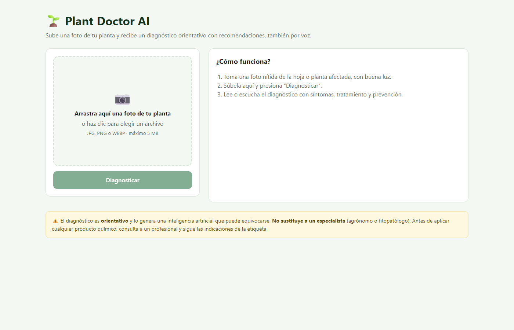
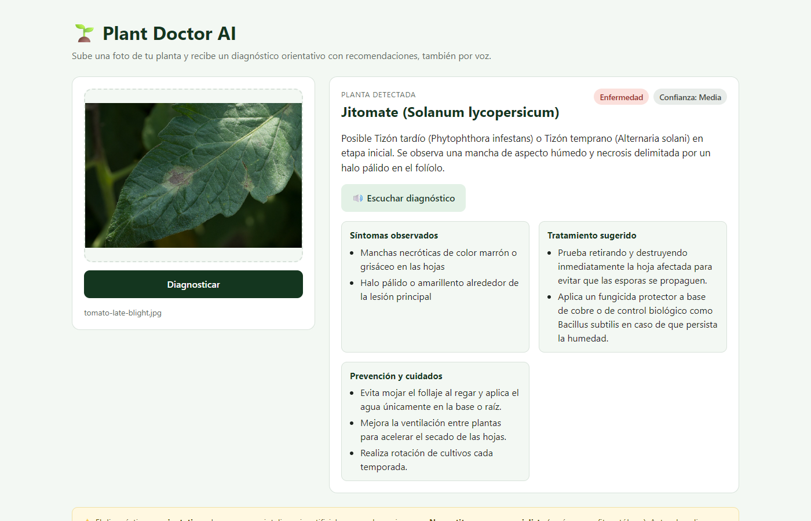
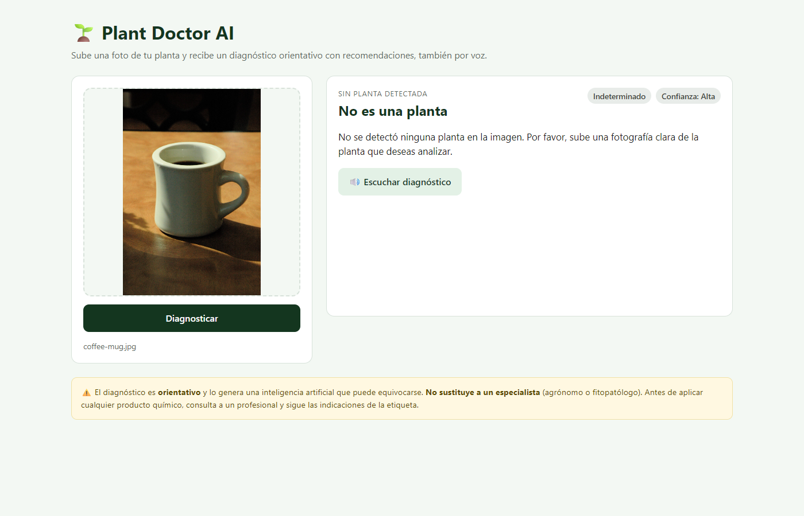

# 🌱 Plant Doctor AI

AI plant diagnosis platform: a React app that combines **image analysis** with a **language model**
to give care recommendations, and delivers the answer **by voice**.

Upload a photo of a plant, press **Diagnosticar**, and you get:

- the plant name, a health status badge (healthy, disease, pest, nutrient deficiency) and a confidence level,
- visible symptoms, a suggested treatment and prevention tips,
- a short spoken summary (🔊 *Escuchar diagnóstico*) in Mexican Spanish.

The UI is in Spanish (Mexico); the code and docs are in English.

> ⚠️ The diagnosis is for guidance only. It is generated by an AI model that can be wrong and is
> **not a substitute for an agronomist or plant pathologist**.

## Screenshots

| Start screen | Diseased leaf | Not a plant |
| --- | --- | --- |
|  |  |  |

The sample photos are from Wikimedia Commons (see [attribution](docs/samples/ATTRIBUTION.md)), and the
real API responses are saved next to them in [`docs/samples/`](docs/samples).

## Architecture

```
┌──────────────────────┐   POST /api/diagnose    ┌──────────────────────────┐   generateContent    ┌──────────────────┐
│  Browser (React)     │  multipart: image ───▶  │  Express API (Node + TS) │  image + prompt ───▶ │  Google Gemini   │
│                      │                         │                          │  + responseSchema    │  (vision model)  │
│  - file picker/drop  │  ◀─── Diagnosis JSON    │  - multer: type & size   │  ◀─── JSON text      │                  │
│  - result card       │                         │  - rate limit (per IP)   │                      └──────────────────┘
│  - speak() → Web     │                         │  - zod validation        │
│    Speech API        │                         │  - GEMINI_API_KEY (.env) │
└──────────────────────┘                         └──────────────────────────┘
        no API key here                             the key only lives here
```

- **The API key never reaches the browser.** The React app only talks to its own backend (`/api/...`).
  In development, Vite proxies `/api` to Express. The server sends the key to Gemini in the
  `x-goog-api-key` header (not in the URL), and never logs it.
- **The AI call sits behind an interface.** `PlantAnalyzer` has one method, `analyze(image)`.
  `GeminiPlantAnalyzer` is the real implementation; tests inject a fake one through `createApp({ analyzer })`.

```
server/src/
  index.ts           # entry point: reads config, wires the real analyzer, starts the server
  app.ts             # Express app: routes, upload rules, error handling (no AI code here)
  analyzer.ts        # PlantAnalyzer interface + AnalyzerError
  geminiAnalyzer.ts  # Gemini REST call (timeout, structured output)
  prompt.ts          # the instructions sent to the model
  schema.ts          # zod schema + the matching Gemini responseSchema
  rateLimit.ts       # tiny in-memory rate limiter
  config.ts          # environment variables
web/src/
  App.tsx            # page state: file, loading, result, error
  api.ts             # client-side checks + fetch to /api/diagnose
  speech.ts          # speak()/stopSpeaking() voice abstraction
  components/        # ImagePicker (drag & drop + preview), ResultCard
```

## Structured output design

Free-form LLM text is hard to display reliably, so the server asks Gemini for **JSON that follows a schema**:

```jsonc
{
  "isPlant": true,
  "plantName": "Jitomate (Solanum lycopersicum)",
  "healthStatus": "diseased",          // healthy | diseased | pest | nutrient_deficiency | unknown
  "diagnosis": "Tizón foliar ...",
  "confidence": "high",                // low | medium | high
  "symptoms": ["..."],
  "treatment": ["..."],
  "prevention": ["..."],
  "speechSummary": "2–3 sentences in Spanish, written to be read aloud."
}
```

1. `schema.ts` defines the shape **once** with zod, and also exports the equivalent Gemini
   `responseSchema`. A unit test checks that both stay in sync.
2. The request uses `responseMimeType: "application/json"` + `responseSchema`, `temperature: 0.2`,
   and the photo as `inline_data` (base64).
3. `prompt.ts` tells the model how to classify, to answer in Mexican Spanish, to lower its confidence
   when unsure, and what to do when the photo is **not a plant** (`isPlant: false`, empty lists,
   a friendly message).
4. Even with a schema, the model output is **validated again with zod** before it reaches the browser.
   `speechSummary` is a separate field so the voice reads a short summary instead of the whole card.

## Validation & error handling

| Situation | Response |
| --- | --- |
| No file / wrong field name | `400` `{ "error": "No se recibió ninguna imagen..." }` |
| File is not JPEG, PNG or WEBP | `400` `{ "error": "Formato no permitido..." }` |
| File larger than 5 MB | `413` `{ "error": "La imagen es demasiado grande..." }` |
| More than 10 requests per minute from one IP | `429` + `Retry-After` header |
| Gemini fails, times out (30 s) or returns JSON that does not match the schema | `502` `{ "error": "No pudimos obtener un diagnóstico..." }` |
| Photo is not a plant | `200` with `isPlant: false` and an explanation |

- Uploads are kept in memory (never written to disk).
- The browser also checks type and size before uploading, for instant feedback; the server checks again.
- Server logs contain only short error messages, never request bodies, headers or keys.

## Voice

Voice output goes through a small abstraction in [`web/src/speech.ts`](web/src/speech.ts):
`speak(text)` / `stopSpeaking()`. Today it uses the browser's **Web Speech API**
(`speechSynthesis`), preferring an `es-MX` voice and falling back to any Spanish voice. It is free and
needs no backend. Available voices depend on the browser and operating system.

**Planned:** an **Amazon Polly** endpoint on the server (e.g. `POST /api/speech` returning an MP3 with a
neural Mexican Spanish voice). Because the UI only calls `speak()`, switching will not require UI changes.

## How to run

Requirements: **Node.js 20.19+ or 22.12+** and a free Google AI Studio API key
(<https://aistudio.google.com/apikey>).

```bash
# 1) API server
cd server
npm install
cp .env.example .env          # then put your key in GEMINI_API_KEY
npm run dev                   # http://localhost:3001

# 2) Web app (in another terminal)
cd web
npm install
npm run dev                   # http://localhost:5173
```

Environment variables (`server/.env`):

| Variable | Default | Notes |
| --- | --- | --- |
| `GEMINI_API_KEY` | — | Required. Never commit it (`.env` is git-ignored). |
| `GEMINI_MODEL` | `gemini-3.5-flash` | Any vision-capable Gemini model that supports `generateContent`. |
| `GEMINI_THINKING_LEVEL` | `low` | Keeps Gemini 3.x answers around 10 s. Leave empty for models without thinking support. |
| `PORT` | `3001` | |

To list the models your key can use:

```bash
curl -s -H "x-goog-api-key: $GEMINI_API_KEY" \
  "https://generativelanguage.googleapis.com/v1beta/models?pageSize=200" | grep '"name"'
```

Production build: `npm run build && npm start` in `server/`, and `npm run build` in `web/`
(serve `web/dist` behind the same domain as the API, or behind a reverse proxy for `/api`).

## Tests

```bash
cd server && npm test        # vitest + supertest, uses a fake analyzer (no key, no network)
cd web && npm run build      # type-check + production build
```

The server suite (22 tests) covers: the success response shape, the analyzer receiving the right bytes and
MIME type, wrong MIME type → 400, file over 5 MB → 413, missing file / wrong field → 400,
analyzer error or invalid model JSON → 502, non-plant response, rate limit → 429, health check,
the zod schema (valid, not JSON, bad enum, missing field), schema/responseSchema sync, the prompt and
request builders, config defaults, and the rate-limit window reset.

GitHub Actions ([`.github/workflows/ci.yml`](.github/workflows/ci.yml)) runs the server tests and the
web build on every push and pull request. CI does not need the API key.

## Limitations

- **The model can be wrong.** It can misidentify a species, confuse diseases with similar symptoms
  (for example, late blight vs. early blight), or sound confident when it should not. The same photo can
  get slightly different answers on different runs. Treat the result as a first hint, not a diagnosis:
  **it does not replace an agronomist or plant pathologist**, especially before applying chemicals.
- One photo shows only part of the plant; root, soil and watering problems are often invisible.
- The rate limiter lives in memory, so it resets on restart and does not work across several instances.
- Voice quality depends on the voices installed in the user's browser/OS.
- Photos are sent to Google's Gemini API for analysis; check its terms before using real user data.

## Roadmap

- [ ] Amazon Polly voice endpoint (`POST /api/speech`) with a neural es-MX voice.
- [ ] Diagnosis history (save past photos and results per user).
- [ ] Retry with backoff when the model is temporarily overloaded (HTTP 503).
- [ ] Multiple photos per diagnosis (whole plant + close-up of the leaf).
- [ ] Deploy (API + static web) with HTTPS.

---

Author: **Jovany Morales del Ángel** · MIT License
